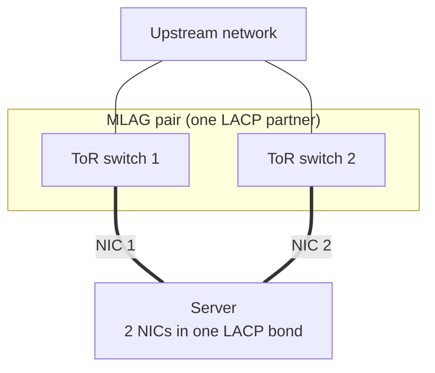
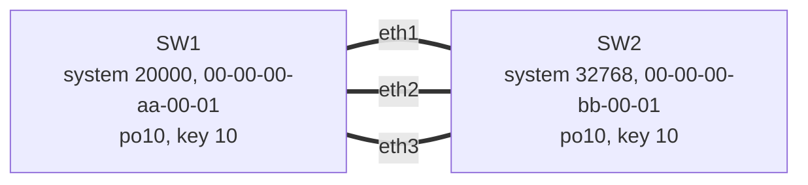
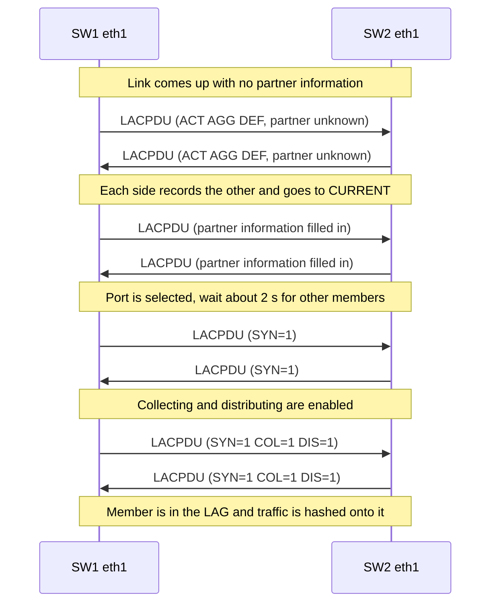
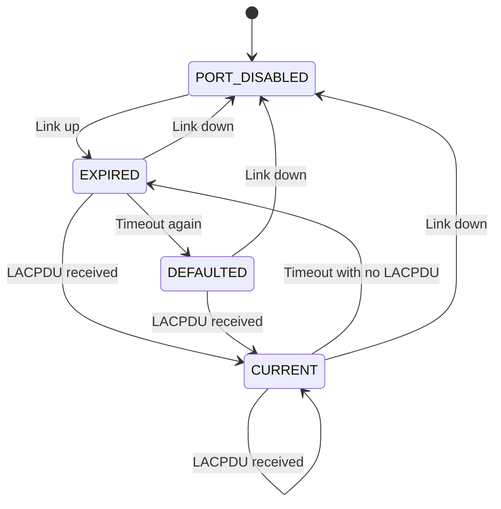
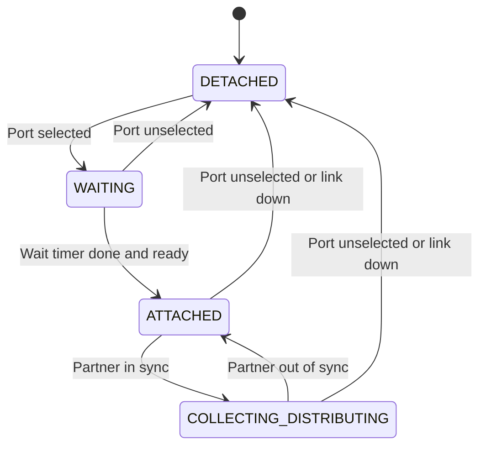
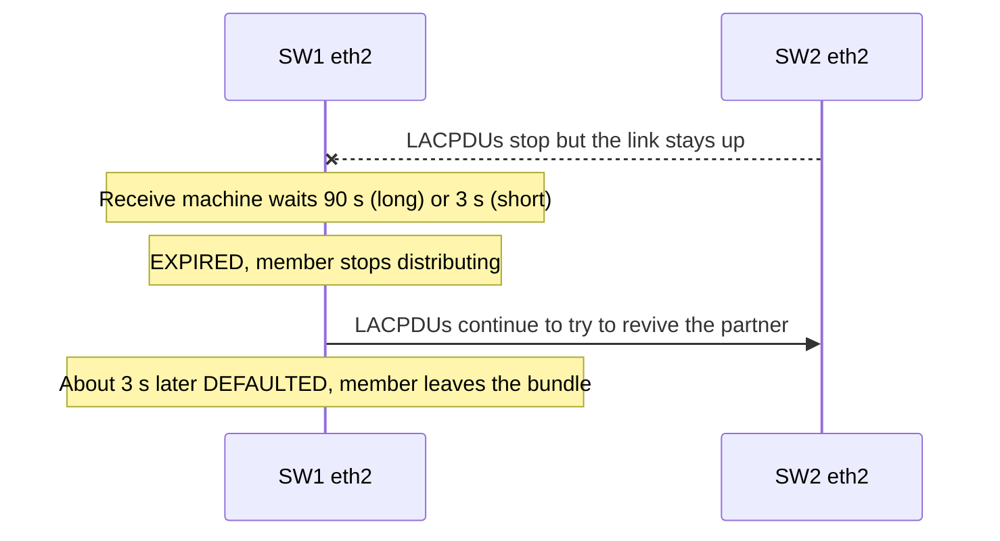

# LACP Protocol: How Links Join and Leave a LAG

How LACP (IEEE 802.1AX, originally 802.3ad) works internally, explained with one worked example: three physical links between two OcNOS switches are bundled into a LAG, and then members are removed in different ways.

> [!NOTE]
> The MAC addresses, priorities and timings in the example are illustrative, not captured output.

## Contents

- [What is LACP and where it is used](#what-is-lacp-and-where-it-is-used)
- [What LACP does on each port](#what-lacp-does-on-each-port)
- [The LACPDU](#the-lacpdu)
- [Timers](#timers)
- [The example](#the-example)
- [Part 1: members join the LAG](#part-1-members-join-the-lag)
- [The state machines](#the-state-machines)
- [Part 2: members leave the LAG](#part-2-members-leave-the-lag)
- [Timing summary](#timing-summary)
- [Watching it on OcNOS](#watching-it-on-ocnos)
- [Adding and removing members safely](#adding-and-removing-members-safely)
- [Interview questions](#interview-questions)
- [Common mistakes](#common-mistakes)

## What is LACP and where it is used

### Definition

**LACP (Link Aggregation Control Protocol)** is the control protocol that builds and maintains a LAG automatically.
Two switches (or a server and a switch) exchange small LACP messages (LACPDUs) over each physical link to agree which links belong to the same bundle, 
and keep checking that each link is still healthy.

- LACP only **controls** the bundle. It does not carry user data and it does not balance traffic. Load balancing is a separate hash that
  each side applies when transmitting.
- A LAG is the result. LACP is one way to build it. The other is a static LAG (see the separate LAG notes), where nothing is negotiated.

### Standard and history

| Year | Event |
|---|---|
| March 2000 | The 802.3ad clause was added to IEEE 802.3 |
| 3 November 2008 | The protocol moved to the 802.1 group as IEEE 802.1AX-2008 |
| 2020 | Latest revision, IEEE 802.1AX-2020, approved 30 January 2020 |

The standard defines aggregating parallel **full-duplex point-to-point** links into a group that the layer above treats as one link. The member links must be full duplex and have identical speed. Many people still say "802.3ad" for LACP, which is the old name.

### What LACP adds over a static LAG

- It detects wrong cabling or a wrong partner, because both ends must agree on the system ID and key before a link joins.
- It removes a failed link from the bundle automatically, including a silent failure that link state does not show.
- It tracks the health of every member while the LAG is up.
- It lets you hold spare links in standby, using port priority, so that they join only when an active link fails.

The trade-off is a little more complexity, and some low-end devices do not support LACP.

### Where it is used

| Place | Typical example | Why LACP |
|---|---|---|
| Switch to switch | Access to distribution, distribution to core, leaf to spine | More bandwidth and redundancy between two switches, with STP seeing one link |
| Server or storage to switch | A server with two or more NICs bonded to a top-of-rack switch | Server survives a NIC or cable failure, and uses all NICs |
| Server to a pair of switches | One NIC to each of two switches that run MLAG | Survives a whole switch failure. The server sees one LACP partner |
| Appliance to network | Firewall, load balancer or SD-WAN box uplinked to the core | Same: bandwidth plus failure handling |
| Backbone upgrade | Using extra cabling that is already installed | More capacity without buying a faster port |
| Between MLAG peers | The link that connects the two MLAG switches is commonly built as a LAG too † | Same benefits, on the peer link |

Examples from specific platforms: Linux bonds use the 802.3ad mode for LACP, and hypervisor virtual switches (for example a VMware distributed switch) can run LACP toward the physical switches. †

### Example: a dual-homed server



How it works:

1. The two switches present the **same LACP system ID** to the server, so the server sees both of its links going to one partner.
2. Both links are active at once. In the NVIDIA cluster design this is contrasted with active/standby bonding, which leaves half the uplink bandwidth unused.
3. If one switch fails, the server keeps working over the other link.
4. The gateway also needs redundancy (VRRP or an equivalent), otherwise the default gateway is still a single point of failure.

**A practical catch with servers:** a server that boots over the network (PXE) cannot negotiate LACP until its operating system is running. Some switch platforms offer an LACP bypass or fallback mode that lets one member forward before negotiation completes. NVIDIA's Cumulus design uses this for PXE provisioning. Check how your platform names and handles it.

### Where LACP is not the right tool

| Situation | Why |
|---|---|
| You want one transfer to go faster than one link | A single flow stays on one member, so it is capped at that link's speed |
| The two ends are independent switches with no MLAG or stacking | Classic LACP cannot span independent switches |
| The peer does not support LACP | Use a static LAG, and accept that nothing checks the other end |
| Members differ in speed or duplex | The standard requires identical speed and full duplex |
| You need complete high availability | A LAG alone is not complete HA. The gateway, the switches and the paths above also matter |

Some designs use separate routed links with ECMP instead of a LAG. †

## What LACP does on each port

LACP runs per member port. For every port it answers three questions:

1. Is there a partner, and who is it? (system ID and key)
2. Can this port be bundled with the other ports facing the same partner?
3. Is the partner ready, so that traffic can be sent and received on this port?

Four cooperating pieces do the work on each port:

| Piece | Job |
|---|---|
| Receive machine | Tracks what the partner last told us and whether that information is still fresh |
| Periodic transmission machine | Decides how often to send LACPDUs (fast or slow) |
| Selection logic | Decides which aggregator (LAG) the port belongs to |
| Mux machine | Attaches the port to the aggregator and turns frame collecting and distributing on or off |

A fifth idea ties them together: the **NTT flag** (Need To Transmit). Whenever something changes that the partner should know about, the port sets NTT and sends a LACPDU right away, limited to 3 LACPDUs per second.

## The LACPDU

LACPDUs are Slow Protocols frames: destination `01-80-C2-00-00-02`, EtherType `0x8809`, subtype `0x01`. They are never forwarded by a bridge. †

A LACPDU carries the sender's view of itself (actor) and of the other side (partner). †

| Block | Contents |
|---|---|
| Actor information | System priority, system ID (MAC), key, port priority, port number, state flags |
| Partner information | The same fields, as the sender last learned them from the partner |
| Collector information | Maximum delay for frames in the collector (OcNOS shows this as "Collector max delay") |

Because each LACPDU also echoes what the sender knows about its partner, one side can tell when the other side has seen it. That echo is what makes the handshake work.

### State flags

One byte of state is sent in the actor and partner blocks. OcNOS shows the same flags in `show port etherchannel`.

| Bit value | OcNOS name | Set means |
|---|---|---|
| 0x01 | ACT | Active LACP (clear means passive) |
| 0x02 | TIM | Short timeout (clear means long) |
| 0x04 | AGG | Port can be aggregated (clear means individual) |
| 0x08 | SYN | In sync: attached to the aggregator the sender selected |
| 0x10 | COL | Collecting: the port accepts incoming frames |
| 0x20 | DIS | Distributing: the port is used for outgoing frames |
| 0x40 | DEF | Defaulted: partner information is a default, nothing was received |
| 0x80 | EXP | Expired: the last partner information has timed out |

### State values you will recognize

| Value | Flags | Meaning |
|---|---|---|
| 0x45 | ACT, AGG, DEF | Port is up, no partner information yet. This matches the OcNOS admin state |
| 0x05 | ACT, AGG | Partner heard, port not yet in sync |
| 0x0D | ACT, AGG, SYN | Attached to the aggregator, not yet carrying traffic |
| **0x3D** | ACT, AGG, SYN, COL, DIS | Fully operational, long timeout |
| 0x3F | The same plus TIM | Fully operational, short timeout |
| 0x3C | AGG, SYN, COL, DIS | Fully operational, passive |

A healthy member shows `0x3D` or `0x3F` on **both** the actor and the partner side.

## Timers

| Timer | Value | Purpose |
|---|---|---|
| Fast periodic time | 1 s | LACPDU interval when the partner asks for short timeout |
| Slow periodic time | 30 s | LACPDU interval when the partner uses long timeout |
| Short timeout time | 3 s (3 times fast) | Partner information expires after this long without a LACPDU |
| Long timeout time | 90 s (3 times slow) | Same, for the long setting |
| Aggregate wait time | 2 s | Delay before a selected port is attached, so ports that come up together join together |
| Churn detection time | 60 s | A member that has not reached sync by then is flagged as churning † |
| Transmit limit | 3 LACPDUs per second | Cap on how fast NTT can trigger sends |

In OcNOS the setting is `lacp timeout short` or `long` (default long, interface mode).

## The example



Both switches use the same configuration style. Only SW1 changes its system priority.

```text
configure terminal
lacp system-priority 20000
interface po10
 switchport
 bridge-group 1
 switchport mode trunk
exit
interface eth1
 channel-group 10 mode active
exit
interface eth2
 channel-group 10 mode active
exit
interface eth3
 channel-group 10 mode active
exit
commit
```

- Both ends are **active** and use the default **long** timeout.
- SW1 has the lower system priority (20000 against 32768), so SW1 is the system that decides member selection if there are ever more links than the bundle can use.
- The keys are assigned automatically (OcNOS shows them as Admin and Oper key).

## Part 1: members join the LAG

We follow `eth1` first. `eth2` and `eth3` repeat the same steps.



### Step by step

**Step 0. Configured, link not up.**
`channel-group 10 mode active` is applied, but the link is down. The Receive machine sits in PORT_DISABLED and the Mux machine in DETACHED. The port's admin state is `ACT:1 AGG:1 DEF:1` (value 0x45). There is no partner, so `show etherchannel detail` shows a partner LAG ID of all zeros.

**Step 1. Link comes up.**
The Receive machine moves to EXPIRED. Until the port hears the partner it assumes the partner wants short timeouts, so LACPDUs go out about once a second even though both ends are configured for long. Each LACPDU carries the actor information and an empty partner block. State: `ACT AGG DEF`.

**Step 2. First LACPDU arrives.**
The Receive machine records the partner's system ID, key, port and state, clears DEF, and moves to CURRENT. The partner's state tells SW1 that SW2 uses the long timeout, so SW1 drops to the slow periodic rate. The current-while timer is now 90 s and is restarted by every LACPDU.

**Step 3. The partner confirms it has seen us.**
SW2's next LACPDU carries SW1's own information in its partner block. When what the partner says about us matches what we are, the port is **matched**. This is why a join takes at least one full exchange in each direction.

**Step 4. Selection.**
The Selection logic builds the LAG ID from the actor system and key plus the partner system and key. For `eth1` this gives one aggregator, `po10`. The port is marked SELECTED. The Mux machine moves from DETACHED to **WAITING** and starts the 2 second aggregate wait timer.

**Step 5. Aggregate wait, then attach.**
The wait gives `eth2` and `eth3` time to be selected too, so the aggregator is reprogrammed once instead of three times. When the timer ends and the port is ready, the Mux machine moves to **ATTACHED**. The port is now bound to the aggregator and sets SYN. The state becomes `ACT AGG SYN` (0x0D). NTT is set and a LACPDU announces SYN=1.

**Step 6. The partner is in sync, so frames can flow.**
When a LACPDU arrives showing SYN=1 from the partner, the Mux machine turns collecting and distributing on. State: `ACT AGG SYN COL DIS` (0x3D).

- Many implementations treat collecting and distributing as one step, called **coupled control**: the state is COLLECTING_DISTRIBUTING. †
- Others turn collecting on first and distributing only after the partner shows COL=1.

**Step 7. Steady state.**
Both ends show `0x3D` for actor and partner. `eth1` is now one of the hash targets of `po10`, and the LAG interface comes up once enough members are distributing (min-links, if set). LACPDUs continue every 30 seconds, and each one resets the 90 second timer.

`eth2` and `eth3` go through the same steps. If they come up within the 2 second aggregate wait they attach together.

### The same story as a table

| Step | Receive machine | Mux machine | Actor flags (typical) | Partner info |
|---|---|---|---|---|
| 0. Link down | PORT_DISABLED | DETACHED | ACT AGG DEF (0x45) | None |
| 1. Link up | EXPIRED | DETACHED | ACT AGG DEF | None |
| 2. First LACPDU | CURRENT | DETACHED | ACT AGG (0x05) | Recorded |
| 4. Selected | CURRENT | WAITING | ACT AGG | Matched |
| 5. Wait over | CURRENT | ATTACHED | ACT AGG SYN (0x0D) | Partner not yet in sync |
| 6. Partner in sync | CURRENT | COLLECTING_DISTRIBUTING | ACT AGG SYN COL DIS (0x3D) | 0x3D |
| 7. Steady | CURRENT | COLLECTING_DISTRIBUTING | 0x3D | 0x3D |

## The state machines

### Receive machine

It owns the question "is the partner information still valid?"



| State | Meaning |
|---|---|
| PORT_DISABLED | The link is down, or the port is not enabled |
| EXPIRED | No fresh LACPDU. Partner is assumed to want short timeouts and is treated as out of sync. A short timer (3 s) is running |
| DEFAULTED | Still nothing. Partner information is replaced by defaults, so the port is no longer bundled with a real partner |
| CURRENT | Valid partner information. The timer (3 s or 90 s, depending on the timeout setting) restarts on each LACPDU |

IEEE 802.1AX also has INITIALIZE and LACP_DISABLED states for startup and for ports where LACP is turned off. †

### Mux machine

It owns the question "is this port attached, collecting and distributing?"

The diagram leaves out a short transient ATTACH state that sits between WAITING and ATTACHED. It is where the port is actually bound to the aggregator, and it passes straight through to ATTACHED.



| State | Port bound to aggregator | Receiving (COL) | Sending (DIS) |
|---|---|---|---|
| DETACHED | No | No | No |
| WAITING | No, waiting for the aggregate wait timer | No | No |
| ATTACHED | Yes, SYN set | No | No |
| COLLECTING_DISTRIBUTING | Yes | Yes | Yes |

### Selection logic

For each port the Selection logic marks one of three results:

| Result | Meaning |
|---|---|
| SELECTED | The port belongs to an aggregator and can go on to attach |
| STANDBY | The port could join but the aggregator is full. It waits as a spare |
| UNSELECTED | The port cannot join, for example because its partner or key differs from the others |

Rules that matter:

- Ports with the **same actor key** and the **same partner system and key** go into the same aggregator.
- A port whose partner differs is kept out of that aggregator.
- If more ports qualify than the aggregator can use, the system with the **lower system priority** decides. It picks members by **lower port priority**, then by port number.
- When the LAG ID changes, because the partner changed for example, the port becomes unselected and starts again.

## Part 2: members leave the LAG

A member can leave in six different ways. They look similar in the end, but they are detected very differently.

| Scenario | How the leave is detected | Typical time to stop using the member |
|---|---|---|
| A. Link goes down | Loss of carrier | Immediate |
| B. Admin removal on one side | LACPDUs stop or show SYN=0 | Depends on timeout (up to 90 s on the other side) |
| C. Silent failure, link stays up | LACPDU timeout | 3 s (short) or 90 s (long) |
| D. Wrong cabling or mismatch | Partner ID or key differs | Seconds, at selection |
| E. Too few active members | min-links check | Immediate once the count drops |
| F. Standby member promoted | An active member leaves | Seconds |

### A. The link goes down

You pull `eth3` or shut it down.

1. The port is no longer enabled. The Receive machine goes to PORT_DISABLED.
2. The Mux machine goes to DETACHED. Collecting and distributing stop, and SYN is cleared.
3. The hash now spreads traffic over `eth1` and `eth2`. Flows that were on `eth3` move.
4. The other switch sees carrier loss on its end of the same cable and does the same.

This is the fast, common case and does not wait for any LACP timer.

### B. A member is removed by configuration on one side

On SW1 you run `no channel-group 10` on `eth3`.

1. SW1 takes `eth3` out of the aggregator. The port stops running LACP and returns to default interface properties.
2. SW1 stops distributing and collecting on `eth3`.
3. Whether SW1 sends a final LACPDU with SYN=0 depends on the implementation. Assume it may not.
4. SW2 still has `eth3` configured and keeps sending and receiving on it until it sees something change. With the long timeout that can take up to 90 seconds.

Hence the rule: **take the link down first, then change the configuration** (see [Adding and removing members safely](#adding-and-removing-members-safely)).

### C. Silent failure: the link stays up but LACPDUs stop

Examples: a device between the switches that stops passing the multicast frames, a one-way fault, or a peer whose LACP process stopped.



1. In CURRENT the Receive machine's timer runs out: 90 s with long timeout, 3 s with short.
2. It moves to **EXPIRED**. The partner is treated as out of sync, so the Mux machine drops from COLLECTING_DISTRIBUTING back to ATTACHED. SW1 stops using `eth2`.
3. The short timer (about 3 s) starts and SW1 keeps sending LACPDUs, hoping to hear back.
4. If nothing arrives it moves to **DEFAULTED**. The partner information is replaced with defaults, the port is no longer part of the bundle with that partner, and depending on the platform it runs as an individual port or is held out.

> [!IMPORTANT]
> Until the timer expires, SW1 keeps hashing flows onto the dead link and those flows are lost. With the default long timeout that can be about 90 seconds. This is the main reason to use `lacp timeout short` on links where a silent failure is a real risk.

OcNOS note: `lacp force-up` changes this for one member. A force-up port ignores the timeout when LACPDUs stop and stays in operation.

### D. Wrong cabling or a mismatch

Suppose `eth3` on SW1 is by mistake cabled to a third switch, SW3.

1. SW3's LACPDU carries a different system ID.
2. The partner for `eth3` now differs from the partner for `eth1` and `eth2`, so the LAG ID differs.
3. The Selection logic does not allow `eth3` into the same aggregator. It is left out (and on some platforms placed in a second aggregator). `eth1` and `eth2` keep working.

A static LAG would have bundled all three ports, and flows hashed to `eth3` would go to the wrong switch. This is the main practical advantage of LACP.

Similar causes: a changed key, a member with different speed or duplex, or LACP turned off on one end.

### E. Fewer active members than min-links

With `port-channel min-links 2` on both ends and only one member active, the LAG interface goes down even though that member is still healthy. OcNOS shows the LAG as protocol down (`PD(Min L/B)` in the brief output). It comes back when enough members are active again. The values must match on both ends.

### F. A standby member takes over

When there are more ports than the bundle can carry, the extras are marked STANDBY and held in the WAITING state, not attached. If an active member leaves, the best standby (lowest port priority number) is selected, attached and goes through the usual Mux steps, so it takes a few seconds to start carrying traffic.

## Timing summary

| Event | Approximate time |
|---|---|
| Link up to member carrying traffic | A few seconds. LACPDUs start at about one per second, then add the 2 s aggregate wait |
| Link down to member removed from hash | Immediate |
| Silent failure with long timeout | About 90 s before the member is dropped |
| Silent failure with short timeout | About 3 s |
| Configuration removal on one side | Up to the peer's timeout |
| Extra member joining an already-built bundle | A few seconds, including the 2 s wait |

## Watching it on OcNOS

| What you want to see | Command | What to look for |
|---|---|---|
| Local system ID and priority | `show lacp sys-id` | Priority and MAC. The sample shows `8000` plus a MAC |
| Per-member LACP state | `show port etherchannel eth1` | Flags `ACT TIM AGG SYN COL DIS DEF EXP` for actor and admin state |
| Partner learned or not | `show etherchannel detail` | Partner LAG ID all zeros means no partner yet |
| Bundle and member list | `show etherchannel summary` | Aggregator, keys and member links |
| LACPDUs flowing | `show lacp-counter 10` | Sent and received counters should increase |

What to expect at each stage:

| Stage | `show port etherchannel eth1` | `show etherchannel detail` |
|---|---|---|
| Link up, no partner | `ACT:1 AGG:1 SYN:0 COL:0 DIS:0 DEF:1` | Partner LAG ID all zeros |
| Joined | `ACT:1 AGG:1 SYN:1 COL:1 DIS:1 DEF:0 EXP:0` | Partner LAG ID filled in |
| Silent failure | SYN, COL and DIS fall back to 0 after the timeout | Receive and transmit link count drops |

The values in the stage table are what the protocol implies at each stage. They are not captured OcNOS output, apart from the "no partner" and "joined" flag patterns, which match the documentation samples.

The Admin state line in the same command shows the configured defaults (`ACT:1 AGG:1 SYN:0 COL:0 DIS:0 DEF:1`), which is useful as a reference when the Oper state looks odd.

> [!NOTE]
> In `show etherchannel detail` the OcNOS reference describes the per-link `sync` field in terms of MAC synchronization for MLAG partners. Do not treat it as the LACP SYN flag. Use `show port etherchannel` for the protocol state.

## Adding and removing members safely

These are operational practices, not requirements from the standard.

**Adding a member**

1. Configure the member on both switches (`channel-group` with the same mode style) before the link comes up, or leave the port shut.
2. Bring the link up.
3. Check that both actor and partner show `0x3D` and that the counters increase.

**Removing a member**

1. Shut the member port on one side. The peer sees the carrier drop immediately, so both ends stop using it at once.
2. Remove the `channel-group` configuration on both sides.
3. Check that the remaining members still meet min-links.
4. Re-enable the port if you want to reuse it elsewhere.

## Interview questions

**What is LACP?**
The control protocol of IEEE 802.1AX (originally 802.3ad) that negotiates and monitors a LAG. Both ends exchange LACPDUs to agree which links bundle and to catch failures and mismatches.

**Where is LACP used?**
Switch-to-switch uplinks, servers and storage bonded to top-of-rack switches, firewalls and load balancers uplinked to the core, and, together with MLAG, servers connected to two switches.

**Does LACP load balance traffic?**
No. LACP only decides which links are in the bundle. Each side balances the traffic it sends with a hash, and the hash fields are configured separately.

**Why use LACP instead of a static LAG?**
LACP detects wrong cabling and a wrong partner, removes a failed link automatically, and keeps checking every member. A static LAG relies on link state only.

**How does a physical port become part of a LAG with LACP?**
It exchanges LACPDUs with the partner, records the partner's system ID and key, gets matched when the partner echoes its own information back, is selected into the aggregator, waits the 2 second aggregate wait, attaches and sets SYN, and then enables collecting and distributing once the partner is in sync.

**Why is there a 2 second wait?**
To let several ports that come up at about the same time be attached together, so the aggregator is not reprogrammed for every port.

**What do the SYN, COL and DIS flags mean?**
SYN: the port is attached to the aggregator the sender selected. COL: the port accepts incoming frames. DIS: the port is used for outgoing frames.

**What state value means a healthy member?**
`0x3D` with the long timeout, or `0x3F` with the short timeout, on both the actor and the partner side.

**How is a failed member detected?**
A link-down is detected immediately from carrier. A silent failure is detected when the LACPDU timeout expires: 3 seconds with short, 90 seconds with long.

**What happens between the timeout and DEFAULTED?**
The Receive machine goes CURRENT, then EXPIRED, where the member stops carrying traffic, then DEFAULTED after another short timeout.

**Why does one member of a LAG sometimes not join?**
Common causes: a different partner or key (wrong cabling), mismatched speed or duplex, passive on both ends, LACP disabled on the peer, or the bundle is full and the port is on standby.

**What happens when a member is removed on one side only?**
The removing side stops using it, but the peer keeps using it until it notices, which can take up to the long timeout. Take the link down first.

**What is the NTT flag?**
Need To Transmit. It makes the port send a LACPDU immediately when its state changes, rather than waiting for the periodic timer, limited to 3 per second.

**What does the lower system priority decide?**
Which of the two systems chooses the active members when there are more candidate links than the bundle supports.

## Common mistakes

| Wrong | Correct |
|---|---|
| "LACPDUs are only sent every 30 seconds" | They start at about 1 per second and slow to the partner's rate once it is known. Changes also trigger an immediate LACPDU |
| "A member joins as soon as the link is up" | It needs the exchange, selection, the 2 s wait and the partner's sync |
| "A removed link is always detected quickly" | Link-down is immediate. Silent failures wait for the timeout |
| "SYN means the LAG is up" | SYN means attached. The member carries traffic only after COL and DIS |
| "Defaulted means the link is down" | The link can be up. DEF means no real partner information is held |
| "Both ends must use the same timeout" | They can differ. Each end tells the other how often to send |
