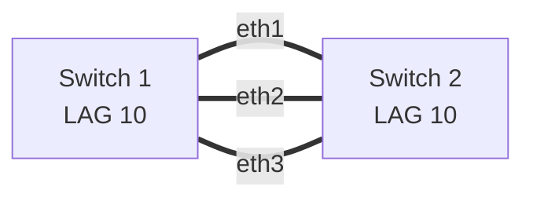
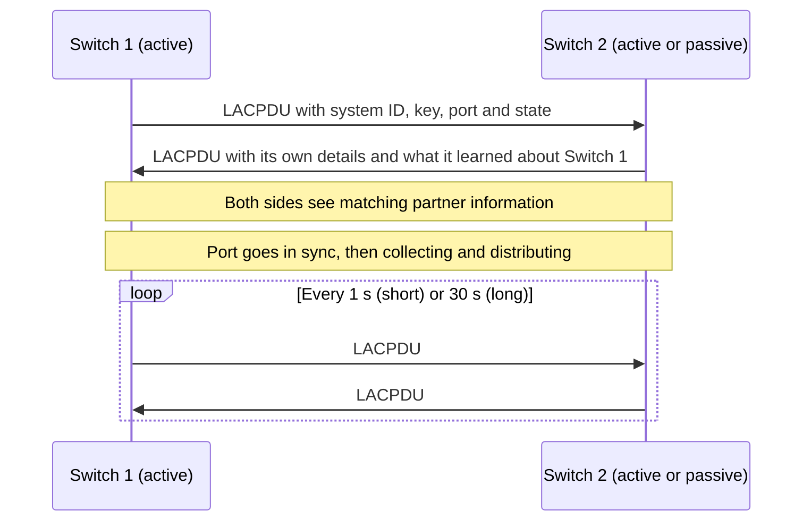

# Link Aggregation (LAG): Static vs Dynamic (LACP)

## Contents

- [Introduction](#Introduction)
- [Static LAG](#static-lag)
- [Dynamic LAG (LACP)](#dynamic-lag-lacp)
- [Static vs dynamic](#static-vs-dynamic)
- [Mode compatibility](#mode-compatibility)
- [OcNOS configuration](#ocnos-configuration)
- [Load balancing](#load-balancing)
- [Member port requirements](#member-port-requirements)
- [Troubleshooting](#troubleshooting)
- [Interview questions](#interview-questions)

## Introduction

A LAG bundles several physical links between two devices into one logical link. It adds bandwidth and redundancy, and spanning tree treats it as a single interface.

- **Static LAG:** you configure both ends by hand. Nothing is negotiated.
- **Dynamic LAG:** uses LACP (IEEE 802.1AX, originally 802.3ad). The two ends exchange LACPDUs to agree which links bundle, and to detect failures and mismatches.

LACP is the safer default. Use static only when the peer cannot run LACP.



**Why use one**

- **Bandwidth:** traffic is spread across the members by a hash.
- **Redundancy:** if one member fails, the others keep carrying traffic.
- **Simpler spanning tree:** the bundle counts as one interface, so STP does not block individual members.

> [!IMPORTANT]
> Traffic is hashed per flow, so a single flow always uses one member. A LAG does not make one flow faster than one member link.

**Names for the same idea**

| Term | Where you see it |
|---|---|
| LAG | Generic and IEEE term |
| Port-channel | Cisco, Arista, OcNOS (`po10`) |
| Static channel | OcNOS (`sa10`) |
| EtherChannel | Cisco. OcNOS also uses it in `show etherchannel` |
| Bond | Linux, Cumulus |
| Aggregated Ethernet (`ae`) | Junos |

The LAG is the bundle. LACP is only one way of building it.

## Static LAG

Members are added by hand on both ends. No protocol runs between them.

**Behavior**

- A member starts forwarding as soon as its link is up.
- Neither end checks that the other end is configured the same way.
- Failure detection relies on physical link state only.

**Risks**

- Miscabling or a one-sided configuration goes unnoticed. Arista notes that static LAGs drop packets if the two ends are configured differently.
- A link that stays up but stops passing traffic is not detected.

**When to use it**

- The peer does not support LACP.
- A design needs fully deterministic behavior and accepts the risk above.

> [!NOTE]
> Vendors disagree about static LAGs in MLAG designs. Arista says static LAG is not recommended in MLAG configurations. Cumulus says static bonds can be useful in MLAG deployments. The right answer depends on the platform and the peer.

## Dynamic LAG (LACP)

Each end sends LACPDUs, so the two ends agree on which links bundle.



### What a LACPDU carries

- **System ID:** system priority plus the system MAC address.
- **Key:** a number that groups ports able to bundle. It is only locally significant and does not have to match the peer.
- **Port ID:** port priority plus port number.
- **State flags:** activity (active or passive), timeout (short or long), aggregation, synchronization, collecting, distributing.

LACPDUs use the Slow Protocols multicast address `01-80-C2-00-00-02` and EtherType `0x8809`.

### Active and passive

| Mode | Behavior |
|---|---|
| Active | Sends LACPDUs and starts the negotiation |
| Passive | Replies only after it hears LACPDUs from the peer |

At least one end must be active. Passive with passive never bundles.

### Choosing the active links

When there are more candidate links than the bundle can use:

1. The system with the **lower system priority** (then the lower MAC) is in charge.
2. That system picks members by **port priority**, where lower wins, then by port number.

### Timers

| Setting | LACPDU send interval | Received LACPDU expires after |
|---|---|---|
| Short (fast) | 1 second | 3 seconds |
| Long (slow) | 30 seconds | 90 seconds |

The timeout is three times the send interval. This is how LACP catches a silent failure that link state does not show, such as a one-way fault or a peer that stopped running LACP. With the slow setting, that can take up to 90 seconds.

## Static vs dynamic

| | Static | Dynamic (LACP) |
|---|---|---|
| Negotiation | None | LACPDUs |
| Standard | Not a protocol | IEEE 802.1AX (802.3ad) |
| Detects miscabling or config mismatch | No | Yes |
| Detects a silent failure | No, link state only | Yes, after the LACPDU timeout |
| Failure when a link goes down | Fast | Fast |
| Peer requirement | Any device that can bundle | LACP on both ends |
| Main risk | Loops or black holes if one side is wrong | Low |
| Recommended | Only if the peer lacks LACP | Default choice |

## Mode compatibility

| Local \ Remote | Static (on) | Active | Passive |
|---|---|---|---|
| **Static (on)** | Forms | Does not form | Does not form |
| **Active** | Does not form | Forms | Forms |
| **Passive** | Does not form | Forms | Does not form |

- On Arista, static against an LACP partner does not form a LAG with the partner. Only the static side aggregates.
- Some platforms offer a fallback feature that lets an LACP port come up even when no LACPDUs arrive (see [OcNOS](#ocnos-configuration) `lacp force-up` and the [other NOS](#other-nos-comparison) table).

## OcNOS configuration

### Interface naming

| | LAG interface | Member command |
|---|---|---|
| Static LAG | `sa<1-16383>` | `static-channel-group <N>` |
| Dynamic LAG | `po<1-16383>` | `channel-group <N> mode active` or `mode passive` |

A new LAG interface is Layer 3 by default. Run `switchport` first if you want a Layer 2 LAG.

> [!NOTE]
> The OcNOS command reference describes `passive` as disabling LACP negotiation, which conflicts with the standard meaning (LACP runs, but only replies). The documentation examples use only `mode active`. In an interview, give the standard definition and say you would confirm the behavior on your release.

### Dynamic LAG example

```text
configure terminal
lacp system-priority 20000
interface po10
 switchport
 bridge-group 1
 switchport mode trunk
 switchport trunk allowed vlan all
exit
interface eth1
 channel-group 10 mode active
exit
interface eth2
 channel-group 10 mode active
exit
commit
```

### Static LAG example

```text
configure terminal
interface sa10
 switchport
 bridge-group 1
 switchport mode trunk
 switchport trunk allowed vlan all
exit
interface eth1
 static-channel-group 10
exit
interface eth2
 static-channel-group 10
exit
commit
```

Both examples assume `bridge 1` and the VLANs already exist. Configure the same LAG on the peer switch.

### Tuning commands

| Command | Mode | Meaning |
|---|---|---|
| `lacp system-priority <1-65535>` | Config | Default 32768. Lower value wins |
| `lacp port-priority <1-65535>` | Interface | Default 32768. Lower value is selected first |
| `lacp timeout short` or `long` | Interface | Default long. Short is 1 s send and 3 s expiry. Long is 30 s send and 90 s expiry |
| `lacp force-up` | Interface | Member forwards without waiting for an LACPDU. See notes below |
| `port-channel min-links <2-32>` | LAG interface | LAG stays down unless enough members are active |
| `port-channel min-bandwidth <n>g` | LAG interface | LAG stays down unless enough bandwidth is active |

**About `lacp force-up`**

- The port is forced up only if no other member of the bundle is in sync.
- If LACPDUs later stop arriving, the port ignores the timeout and stays up.
- Configure it on one member only, after `channel-group ... mode` is set.
- It is not supported in passive mode.
- In MLAG, configure it on only one node (master or slave) to avoid traffic loss or loops.

### Verification

| Command | Shows |
|---|---|
| `show etherchannel summary` | Bundle and member state |
| `show etherchannel detail` | Actor and partner LAG ID, keys, member sync state |
| `show port etherchannel <interface>` | LACP state of one member |
| `show lacp sys-id` | Local system ID and priority |
| `show lacp-counter <N>` | LACPDU counters. A counter that does not move means no LACPDUs |
| `show static-channel-group <N>` | Members of a static LAG |
| `show interface brief po10` | Admin and protocol state of the LAG |

### Rules and behaviors

- Set the LAG interface as a switch port or Layer 3 port before adding members.
- A member takes on the LAG interface's properties and loses its own.
- A member can be moved between a static and a dynamic LAG without removing its configuration first.
- `no static-channel-group` removes the member but keeps the static LAG.
- Only members that are admin up and operationally up count toward min-links.
- If min-links is higher than the number of active members, the LAG goes down and shows `PD(Min L/B)` in the brief output.
- Min-links and min-bandwidth cannot be used together on the same LAG.
- Set min-links and min-bandwidth to the same value on both ends.
- In MLAG designs, do not set min-links or min-bandwidth on both the TOR and the switches at the same time, or the LAG can flap.
- The number of LAG groups and members per LAG depends on the hardware and release. Do not quote a single number.

## Load balancing

- The hash uses packet header fields such as MAC, IP and Layer 4 ports. One flow stays on one member.
- OcNOS fields: `dst-mac`, `src-mac`, `src-dst-mac`, `dst-ip`, `src-ip`, `src-dst-ip`, `dst-port`, `src-port`, `src-dst-port` and `rtag7`.
- OcNOS defaults: `src-dst-mac` on Layer 2 ports and `src-dst-ip` on Layer 3 ports.
- `rtag7` hashes on the IP and Layer 4 header for IP packets, and on the Layer 2 header for other packets.
- Uneven distribution usually means few flows or poorly chosen hash fields. Change the fields.
- Arista notes that using different hash seeds or profiles across switches helps avoid hash polarization.

## Member port requirements

- Same speed and duplex. Some platforms allow mixed speeds with restrictions.
- Same VLAN, trunk and Layer 2 or Layer 3 settings.
- Same MTU.
- A port belongs to only one LAG.
- Create and configure the LAG interface first, then add members.

## Troubleshooting

LACP LAG does not come up:

1. Are the links up, with matching speed and duplex?
2. Is LACP enabled on both ends? Passive with passive never bundles.
3. Is one side static (`on`) while the other runs LACP?
4. Do the members have consistent settings (VLAN or trunk mode, MTU)?
5. Are LACPDUs arriving? Check the LACP counters. If they do not move, look at cabling or at a device in the path that drops the multicast frames.
6. Is min-links or min-bandwidth higher than the number of active members?
7. Compare actor and partner details in `show etherchannel detail`.

## Interview questions

**What is the difference between a static LAG and LACP?**
A static LAG has no negotiation and trusts the configuration on both ends. LACP exchanges LACPDUs, so the ends verify each other, detect misconfiguration, and detect silent failures.

**When would you choose static?**
When the peer does not support LACP, or when a specific design requires it. Otherwise use LACP.

**Do two passive ends form a LAG?**
No. Nobody starts the negotiation. Active with active, or active with passive, works.

**What happens if one side is static and the other is LACP?**
They do not form a proper LAG. The static side bundles, and the LACP side sees no LACPDUs and does not bundle. This can cause loops or black holes.

**Does a LAG make a single flow faster?**
No. Traffic is hashed per flow, so one flow stays on one member.

**How does LACP decide which links are active?**
It compares system priority, then MAC, to find the controlling system. That system chooses members by port priority, then port number.

**What are the LACP timers?**
Short: LACPDUs every 1 second, expiring after 3. Long: every 30 seconds, expiring after 90. In OcNOS the command is `lacp timeout short` or `long`, and the default is long.

**Why might you change the default timer?**
With the long setting, a silent failure can take up to 90 seconds to detect. Short brings that down to about 3 seconds.

**What does min-links do?**
It keeps the LAG down unless enough members are active. Set the same value on both ends.

**What does `lacp force-up` do in OcNOS?**
It lets a member forward without waiting for an LACPDU, but only if no other member is in sync. Use it on one member only, and not in passive mode.

**How are static and dynamic LAGs different in OcNOS?**
Static uses an `sa` interface with `static-channel-group`. Dynamic uses a `po` interface with `channel-group ... mode active` or `passive`.

**How does a LAG relate to MLAG?**
A LAG runs between two devices. MLAG lets one end of the LAG be two switches that present themselves as one logical device.

